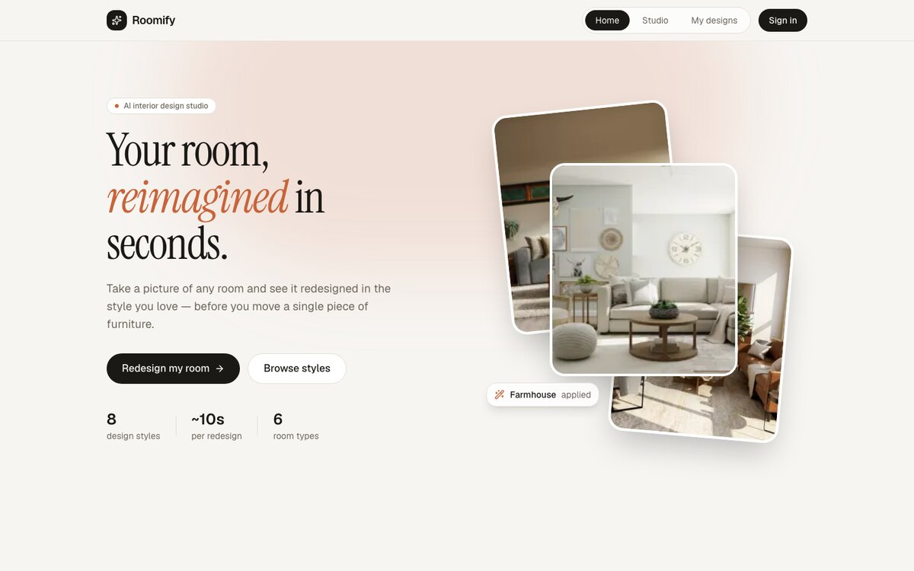
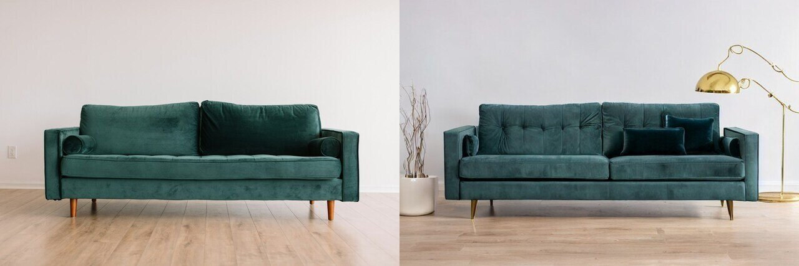
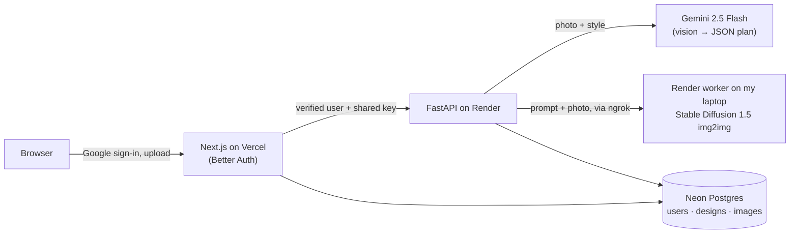

# Roomify — AI interior redesign

Upload a photo of a room, pick a style, and get a photorealistic redesign of *that* room — plus designer notes on what changed, a colour palette and a shopping list.

**Live demo: [roomify-fawn.vercel.app](https://roomify-fawn.vercel.app/)** · sign in with Google · 2 designs per account




*Left: the uploaded photo. Right: a real render — style "Mid-century", wish "warm reading lamp".*

> The image model runs on my own laptop (Apple M1) to keep the project free to host. When it's online you get a real Stable Diffusion render; when it's offline the app still works — you get the AI designer notes with a colour-graded preview, and the page says so.

## Features

- **Photo → redesign** in 8 styles (Modern, Scandinavian, Boho, Minimalist, Mid-century, Coastal, Farmhouse, Industrial) for 6 room types, with free-text wishes and a "keep my room ↔ total makeover" slider
- **AI designer**: a vision LLM looks at the photo, writes a prompt tailored to the room's actual layout, and returns structured notes (title, summary, palette, key changes, shopping list). Non-room photos are rejected
- **Before/after slider**, variations, downloads
- **Google sign-in**; every design is saved to your account and shows up in *My designs* on any device
- **Per-account limit** (2 designs) enforced atomically on the server, so parallel requests can't bypass it
- **Graceful degradation**: if the LLM is busy it retries, falls back to a lighter model, then to a template prompt; if the GPU worker is offline it falls back to a preview — the user always gets a result

## How it works



1. The browser only talks to the Next.js app. Its API routes check the Better Auth session and forward the request to the backend with the user's identity and a shared secret — the backend is never called directly from the browser.
2. The FastAPI backend reserves one of the user's design slots, then asks **Gemini** (structured JSON output) to study the photo and plan the redesign.
3. The plan's prompt and the photo go to the **render worker** — Stable Diffusion 1.5 img2img on my laptop's GPU, exposed through an ngrok tunnel and protected by its own key.
4. The before/after images and the plan are saved; the user sees the result and Gemini's notes.

## Tech stack

| Layer | Tech |
|---|---|
| Frontend | Next.js 16 (App Router, Cache Components), React, TypeScript, Tailwind CSS, Motion |
| Auth | Better Auth with Google OAuth, Drizzle ORM |
| Backend | Python, FastAPI, SQLAlchemy 2 (async), Alembic, Pydantic |
| AI | Google Gemini 2.5 Flash (vision + structured output; Claude supported as an alternative), Stable Diffusion 1.5 via 🤗 Diffusers on Apple MPS |
| Data | Neon Postgres (one database for both apps); images in Postgres or an S3-compatible bucket (Neon Object Storage / GCS / R2) |
| Hosting | Vercel (frontend), Render (API), laptop + ngrok (GPU worker) — all on free tiers |

## Project structure

```
frontend/   Next.js app — pages, studio UI, Better Auth, API routes that proxy to the backend
backend/    FastAPI service — designs API, Gemini planner, image engine, render worker (worker.py)
render.yaml Render blueprint for the backend
docs/       README images
```

More detail: [frontend/README.md](frontend/README.md) · [backend/README.md](backend/README.md)

## Run it locally

Requirements: Node 20+, Python 3.13, and ~3 GB of disk for the Stable Diffusion weights.

```bash
# Backend
python -m venv .venv && .venv/bin/pip install -r backend/requirements-worker.txt
cd backend && cp .env.example .env        # add INTERNAL_API_KEY, GEMINI_API_KEY, RENDER_KEY
../.venv/bin/alembic upgrade head
../.venv/bin/uvicorn app.main:app --port 8000

# Frontend (new terminal)
cd frontend && npm install && cp .env.example .env.local   # Google OAuth keys, BACKEND_API_KEY
npm run db:migrate && npm run dev                          # http://localhost:3000
```

Locally the backend runs Stable Diffusion in-process (`IMAGE_ENGINE=sd`; the first run downloads the model). Set `IMAGE_ENGINE=demo` to work on the app without the model.

### Serving renders for the deployed app

```bash
cd backend && HF_HUB_OFFLINE=1 ../.venv/bin/uvicorn worker:app --port 8001   # GPU worker
ngrok http 8001 --url https://<your-domain>.ngrok-free.dev                  # public tunnel
```

The deployed backend has `IMAGE_ENGINE=remote` and `RENDER_URL` pointing at the tunnel.

## Notes

- Photos are analysed by Google Gemini (free tier) to plan the design.
- Real renders take about a minute on an M1; the free Render instance also needs ~1 minute to wake after 15 idle minutes.
